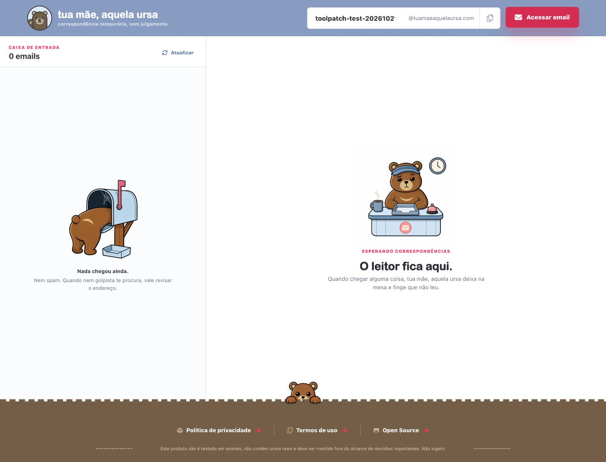

# Validação — 21 de outubro de 2026

Artefato: Toolpatch 0.1.0, SHA-256 `6147c111a0229950619f627ebc27aa946e4bf547cea6fe684a29f8b4df01ab62`.

## Automatizada

Node 22.9.0: `npm ci`, `npm test` (**18 testes passaram**), `npm run build` e `git diff --check`. O build repetido gerou o mesmo hash. Testes exercitam identidade de caixa, respostas HTTP, leitura e limites, cancelamento, prazos, Retry-After, registro, navegação e execução do bundle. Incluem um servidor HTTP local que entrega cabeçalhos e deixa o corpo travado para verificar timeout real.

## Browser com Tampermonkey

O usuário instalou o arquivo completo no Tampermonkey do Browser. Na página real `https://tuamaeaquelaursa.com/toolpatch-test-20261021`, a descoberta nativa mostrou as quatro ferramentas e suas descrições, schemas e annotations.

- `get_mailbox` retornou a caixa selecionada.
- `list_messages` retornou `messages: []`, `hasMore: false`; a interface também mostrou 0 emails.
- `wait_for_message` com prazo de um segundo retornou `status: timeout`.
- A navegação pela interface para `toolpatch-test-20261021-b` atualizou as ferramentas: identificação e listagem passaram a devolver a nova caixa, com quatro ferramentas disponíveis.
- Em `https://example.com/`, nenhuma ferramenta WebMCP estava disponível.

A descoberta imediatamente após carregamento/navegação pode ficar desatualizada durante o registro. Consultar novamente as ferramentas da aba resolveu esse estado; o agente deve usar os nomes recém-descobertos.

## Conteúdo sintético no Browser

`tests/browser/fixture.html` importa o adaptador real, fornece um email sintético e o registra na API WebMCP nativa. `read_message` devolveu `Hello & goodbye.` de um corpo HTML com script, estilo e imagem. O marcador de execução permaneceu ausente; o servidor não recebeu a requisição da imagem. O teste não usa emails reais.

Para repetir essa prova isolada, na raiz do projeto execute `python3 -m http.server 8766 --bind 127.0.0.1` e abra `/tests/browser/fixture.html` nesse servidor com um Browser que ofereça WebMCP nativo. A fixture fornece a própria página e registro; a instalação via Tampermonkey é verificada separadamente no domínio real.

## Limites da evidência

As caixas reais estavam vazias: leitura de conteúdo e encontro por filtro foram validados com mensagens sintéticas. A distribuição atual usa o arquivo raw de `dist/toolpatch.user.js` na `main`; a instalação com atualização automática está descrita no AGENTS.md. Instalações em Windows/Omarchy e compatibilidade com versões antigas de `navigator.modelContext` não foram verificadas.

Se todas as tentativas forem limitadas pelo servidor, a espera termina com `timeout` no prazo; chamadas avulsas devolvem `rate_limited` e o prazo de nova tentativa. Falhas persistentes de registro podem repetir o aviso de diagnóstico a cada segundo; a revisão registrou esse ajuste menor como pendente.
